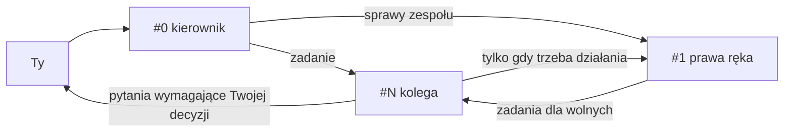

# Tuned Team

Rozszerzenie VS Code, które otwiera zespół agentów Claude Code w jednym oknie. Każdy agent ma swój terminal, kolor i rolę:

- **#0 kierownik** rozmawia z Tobą i rozdziela zadania,
- **#1 prawa ręka** pilnuje stanu zespołu i porządków,
- **#2, #3… koledzy** robią zadania, każdy na własnym branchu.

## Jak to działa

Zamiast jednego okna z agentem masz kilka naraz. Ty rozmawiasz głównie z kierownikiem, a on rozdziela pracę.

```
┌──────────────┬──────────────┬──────────────┐
│ #0 kierownik │ #1 prawa ręka│ #2 kolega    │
├──────────────┼──────────────┼──────────────┤
│ #3 kolega    │ #4 kolega    │ #5 kolega    │
└──────────────┴──────────────┴──────────────┘
```

- Każda kratka to osobny terminal z `claude`, uruchomiony z nazwą okna (`0-kierownik`, `1-prawa-reka`, `3-kolega`) i z rolą z pliku Markdown. Agenci znają się po tych nazwach i piszą do siebie przez `SendMessage`.
- Każde okno ma własny kolor tła, żeby od razu widać było, w którym jesteś. Paleta ma 15 kolorów (`colors.json`), dalej kolory są wyliczane.
- Kierownik dostaje na starcie „start” i pyta Cię, co robimy. Zadania daje wolnym kolegom, krótko i z odwołaniem do zasad w `kolega.md`.
- Kolega pracuje na własnym branchu i osobnym worktree, żeby nie nadpisywać plików innych. Przed scaleniem odpala testy.
- Gdy kierownik potrzebuje więcej rąk, wywołuje `Tuned Team: dodaj kolegę` (adres `…://zbela.tuned-team/add`), a nowe okno pojawia się po prawej.



### Co jest w wersji 0.1.0

- Układ okien, kolory kart, role, dokładanie kolegów i podpisywanie kart numerami.
- Role są zwykłymi plikami Markdown. Możesz je zmienić (sekcja „Własne role” niżej).
- Nie ma okienek systemowych ani dźwięków. Wtyczka niczego nie powiadamia poza oknem edytora.

### Planowane w 0.2.0 (jeszcze nie ma w repo)

Rzeczy, które działają u autora, ale nie zostały jeszcze przeniesione do tego repo:

- **Pasek stanu z procentem kontekstu.** Do 29% zwykły pasek (`repo (main) | Opus | ctx 22%`). Od 30% czerwony procent z opisem limitu kontekstu: agent nie bierze nowych zadań i kończy bieżące. Od 35% przekazuje otwarte zadania koledze z czystym oknem.
- **„DAJ CLEAR'A”.** Gdy kolega skończy, scali pracę i przekaże zadania, wpisuje `tuned-daj-clear`. Pasek pokazuje wtedy duży, kolorowy napis DAJ CLEAR'A. To znak, że można wyczyścić kontekst (`/clear`). Po czyszczeniu napis znika sam.
- **Meldunki bez wiadomości.** `tuned-meldunek start "~15:00" "co robię"`, `eta`, `gotowe "commit abc123"` zapisują stan do pliku, więc nie zużywają tokenów.
- **Tabela zespołu** (`tuned-agenci`): kto czeka na Ciebie, kto pracuje, kto jest wolny, ile ma kontekstu i jaką ETA.

### Limit kontekstu: co to znaczy

Agent „pamięta” rozmowę w oknie o skończonej wielkości, które nazywa się kontekstem. Pasek stanu pokazuje, ile z niego jest zajęte (`ctx 31%`). Im bliżej limitu, tym gorzej agent pracuje i tym drożej, więc po jakimś czasie okno trzeba wyczyścić (`/clear`) i zacząć od zera. Zespół robi to w kolejności, żeby nic się nie zgubiło. Progi to ustawienia autora, nie zasada Claude Code.

Tak wygląda pasek w kolejnych stanach (kolorów na GitHubie nie widać, w edytorze procent jest czerwony od 30%):

```
do 29%    repo (main) | Opus | ctx 22%
od 30%    repo (main) | Opus | ctx 31% · limit kontekstu     agent nie bierze nowych zadań, kończy bieżące
od 35%    repo (main) | Opus | ctx 36% · limit kontekstu     agent przekazuje zadania koledze z czystym oknem
gotowe    repo (main) | Opus | ctx 36%
          █▀▄ ▄▀▄   █   █▀▀ █   █▀▀ ▄▀▄ █▀▄ ▀ ▄▀▄
          █ █ █▀█ ▄ █   █   █   █▀  █▀█ █▀▄   █▀█
          ▀▀  ▀ ▀ ▀▀    ▀▀▀ ▀▀▀ ▀▀▀ ▀ ▀ ▀ ▀   ▀ ▀
          ^ kolega zgłosił tuned-daj-clear: wielki napis DAJ CLEAR'A, czyli wpisz /clear
```

To jest podgląd planowanego wyglądu z 0.2.0, nie zrzut z działającej wtyczki.

### Zadania cykliczne (cron)

Wtyczka niczego nie uruchamia sama w tle. Jeśli chcesz, żeby zespół robił coś co jakiś czas (np. co godzinę sprawdzał nowe commity i robił release), poproś o to kierownika w jego oknie, na przykład:

> Ustaw zadanie cykliczne co godzinę: napisz do prawej ręki „sprawdź nowe commity na main i zrób release, jeśli są”.

Claude Code ma na to polecenie `/loop` i narzędzie do zadań cyklicznych. Zwykle działają tylko tak długo, jak sesja: po zamknięciu okna albo `/clear` ich nie ma i trzeba poprosić ponownie (sprawdź w dokumentacji Claude Code, jak jest w Twojej wersji).

Żeby nie prosić za każdym razem, dopisz to do własnej roli kierownika w `~/.tuned-team/roles/kierownik.md`, w punkcie „Na start”, np. „ustaw zadanie cykliczne co godzinę: …”. Kierownik wykona to przy każdym starcie zespołu. Wbudowana rola kierownika nie ustawia żadnych zadań cyklicznych.

## Wymagania

- macOS albo Linux (w Windows tylko przez WSL).
- VS Code 1.90 lub nowszy. Powinno działać też w Cursorze, Windsurfie i VSCodium, ale tego nie testowałem.
- Zainstalowany [Claude Code](https://claude.com/claude-code) (polecenie `claude` w terminalu) i zalogowane konto.
- `perl` (jest w macOS i w większości Linuksów).

Nie zadziała w PhpStormie ani w innych IDE od JetBrains.

## Instalacja

```sh
git clone git@github.com:zdzislawbela/tuned-team.git
cd tuned-team
./install.sh            # VS Code
./install.sh cursor     # Cursor (analogicznie: windsurf, codium)
```

Jeśli skrypt nie widzi polecenia `code`: w VS Code wciśnij Cmd+Shift+P (Ctrl+Shift+P w Linuksie) i wybierz „Shell Command: Install 'code' command in PATH”, potem uruchom ponownie terminal.

Bez skryptu: Cmd+Shift+P → „Extensions: Install from VSIX…” i wskaż plik z `dist/`.

Po instalacji przeładuj okno (Cmd+Shift+P → „Developer: Reload Window”).

## Użycie

Otwórz folder projektu, potem Cmd+Shift+P:

| Polecenie | Co robi |
|---|---|
| Tuned Team: start | pyta, ilu kolegów, i otwiera zespół |
| Tuned Team: dodaj kolegę | dokłada jeszcze jednego kolegę po prawej |
| Tuned Team: podpisz karty numerami | nadaje kartom nazwy z numerem i kolorem |

Kierownik startuje sam z komunikatem „start” i pyta Ciebie, co robimy.

### Skrót w terminalu (opcjonalnie)

Dodaj do `~/.zshrc`:

```sh
tuned-team() { open "vscode://zbela.tuned-team/team?n=${1:-2}"; }
```

`tuned-team 4` otworzy kierownika, prawą rękę i czterech kolegów. W Cursorze zamień `vscode://` na `cursor://`, w Windsurfie na `windsurf://`. W Linuksie zamiast `open` użyj `xdg-open`.

## Własne role

Role to zwykłe pliki Markdown: `kierownik.md`, `prawa-reka.md`, `kolega.md`. Rozszerzenie bierze je z `~/.tuned-team/roles/` i dopiero gdy ich tam nie ma, używa wbudowanych z `defaults/roles/`.

```sh
mkdir -p ~/.tuned-team/roles
cp defaults/roles/*.md ~/.tuned-team/roles/
```

Zmieniasz tam pliki i otwierasz zespół od nowa. W tekście roli możesz użyć dwóch znaczników: `{{ROLES}}` (folder z rolami, np. do „Zasady: {{ROLES}}/kolega.md”) i `{{ADD_URL}}` (adres, którym kierownik dokłada kolegę).

## Aktualizacja i odinstalowanie

Aktualizacja: `git pull && ./install.sh`. Odinstalowanie: Extensions → Tuned Team → Uninstall. Własne role w `~/.tuned-team/` zostają.

## Dla autora: nowa wersja

```sh
npx --yes @vscode/vsce package --allow-missing-repository --skip-license -o dist/tuned-team-<wersja>.vsix
```

Podbij `version` w `package.json` przed budowaniem i dołącz nowy plik z `dist/` do commita.
